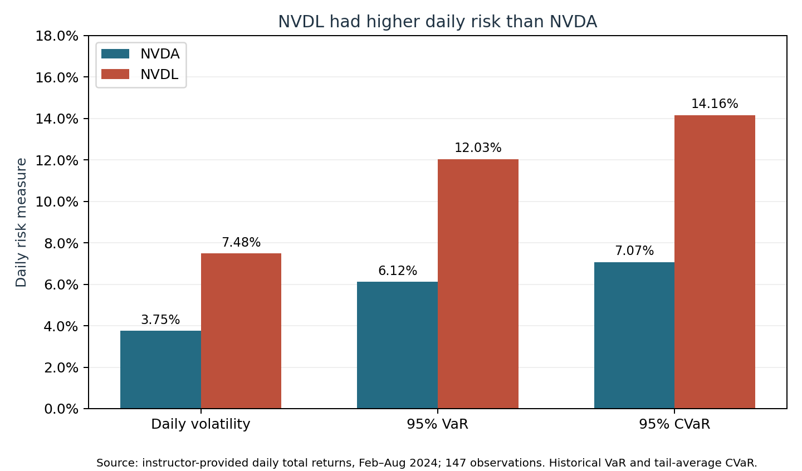
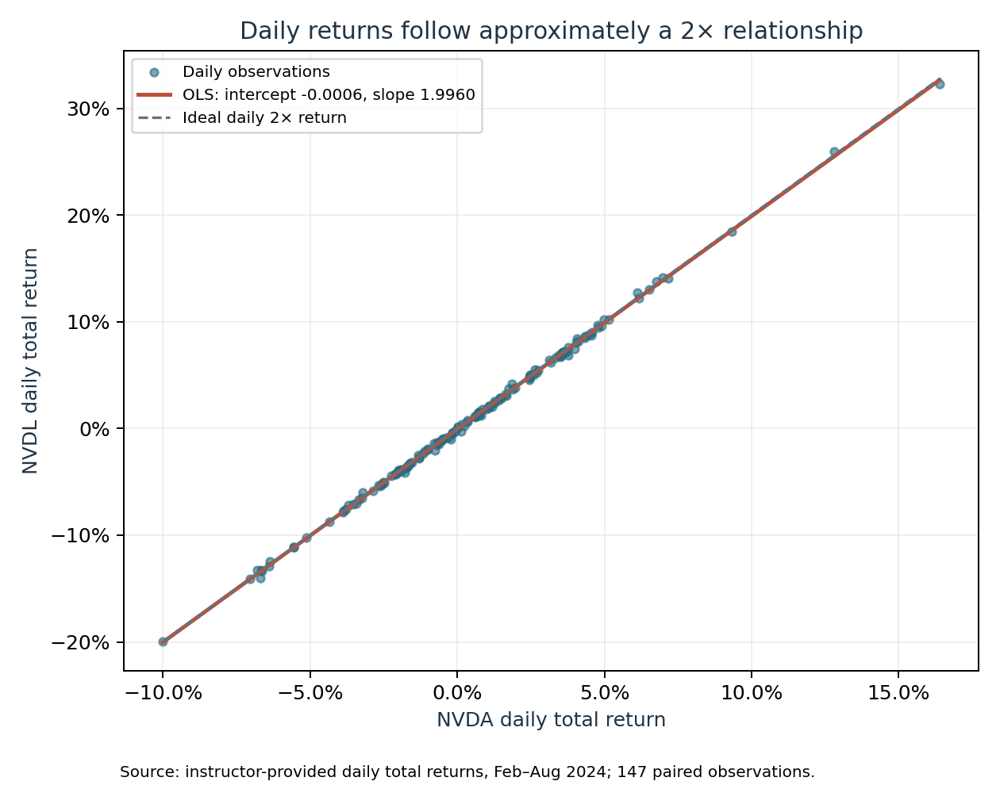
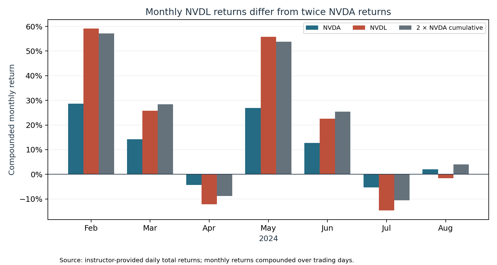
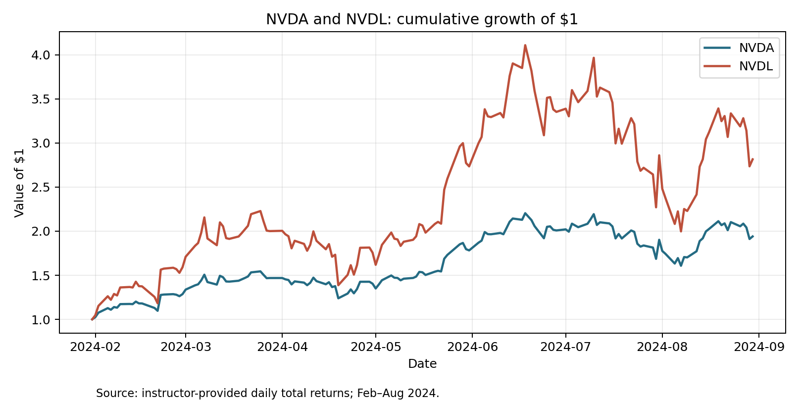

# Part 4: Product innovation — NVDA and NVDL

Source: [instructor-supplied product_innovation.xlsx](../../data/raw/product_innovation.xlsx), NVDL sheet. The sample contains 147 paired daily total returns from February 1 through August 30, 2024. Values in the source and CSVs are decimal returns; the report presents percentages where indicated. The supplier's return construction has not been independently verified. The results are historical, and the Part 4 scripts are not yet integrated into the project runner.

## 4A — daily risk



*Daily volatility, historical VaR and tail-average CVaR for NVDA and NVDL; instructor-provided daily total returns, February–August 2024.*

| Asset | Sample daily standard deviation | 95% historical VaR (loss) | 95% historical CVaR (loss) |
|---|---:|---:|---:|
| NVDA | 3.746% | 6.121% | 7.073% |
| NVDL | 7.479% | 12.029% | 14.162% |

VaR is minus the linearly interpolated 5th percentile of daily returns. CVaR is minus the mean of the eight observed returns at or below that percentile. This empirical tail-average convention may differ from interpolated expected shortfall. Standard deviation uses ddof=1. These are sample daily estimates, not annualized, and support the conclusion that the leveraged fund was riskier in this period.

## 4B — daily regression



*Daily total returns for NVDA and NVDL, the fitted OLS line and the ideal 2× daily return; instructor-provided data, February–August 2024.*

OLS with intercept: NVDL = -0.00061164 + 1.995975 × NVDA + residual. Ordinary OLS 95% t intervals: intercept [-0.00093462, -0.00028867], slope [1.987407, 2.004543], 145 residual degrees of freedom. The slope is close to 2 and the interval contains 2, consistent with the daily exposure objective, but this does not prove the objective was met every day. The objective is before fees and expenses; observed returns reflect fund expenses. Ordinary OLS intervals rely on standard error assumptions.

## 4C — annualized intercept

-0.00061164 × 252 = -15.41% per year, a rough arithmetic annualization of the fitted daily intercept. This does not roughly align with the assignment's 1.15% annual net operating expense ratio. The estimate is noisy and combines other influences; it is not a direct measure of fees or a forecast. Financing or swap costs and trading/market-impact costs are two possible additional sources of drag. Sample composition, data conventions and tracking differences can also affect this comparison; the analysis does not establish a cost breakdown. The 1.15% is the assignment's historical assumption, not a claim about current fees.

## 4D — compounded returns



*Monthly compounded returns for NVDA and NVDL compared with twice NVDA's monthly return; instructor-provided daily total returns, February–August 2024.*



*Growth of $1 in each asset, based on instructor-provided daily total returns, February–August 2024.*

| Period | NVDA | NVDL | 2 × NVDA |
|---|---:|---:|---:|
| Feb | 28.60% | 59.11% | 57.19% |
| Mar | 14.21% | 25.76% | 28.42% |
| Apr | -4.37% | -12.22% | -8.74% |
| May | 26.88% | 55.72% | 53.76% |
| Jun | 12.70% | 22.60% | 25.40% |
| Jul | -5.28% | -14.68% | -10.56% |
| Aug | 2.01% | -1.60% | 4.02% |
| Full period | 94.05% | 181.53% | 188.10% |

Monthly and full-period returns are products of (1 + daily return) minus one. They demonstrate that compounding, daily reset and costs can make returns over more than a day differ from twice the cumulative stock return; August even has positive stock return and negative ETF return. The full-period difference alone cannot attribute the gap to any one mechanism.

## 4E — two-day illustration

NVDA: (1.10 × 0.91) − 1 = +0.10%. Idealized NVDL, assuming exactly twice each daily return and no drag: (1.20 × 0.82) − 1 = -1.60%. A small positive underlying return can therefore coexist with a leveraged ETF loss. This example illustrates the warning without claiming every volatile path loses money.

## 4F — choice for the hypothetical investor

A trader seeking amplified exposure to a single event might choose NVDL if willing to bear roughly doubled daily losses, execution costs and tracking differences; being bullish does not make the outcome certain. A long-term investor who expects volatility may prefer NVDA because the ETF resets daily and its cumulative outcome depends on the path as well as the endpoint. Neither choice is a guarantee; risk capacity and costs matter.

## Data, outputs and reproduction

The [output directory](../../outputs/part4/) contains the daily return panel, daily risk metrics, regression coefficients and confidence intervals, compounded returns, two-day example, and four figures. Returns in the CSVs are decimal fractions. Daily volatility uses the sample standard deviation; VaR and CVaR are reported as positive loss magnitudes.

From the repository root, after installing the documented Python dependencies:

```sh
python src/part4/part4_analysis.py --input data/raw/product_innovation.xlsx --output outputs/part4
python src/part4/part4_figures.py --output outputs/part4
```

The scripts were run locally and the regression, compounding and volatility were independently checked. They have not yet been integrated into `run_all.py` or tested using the repository's pinned environment. Figures and results should be regenerated together if the analysis changes.
