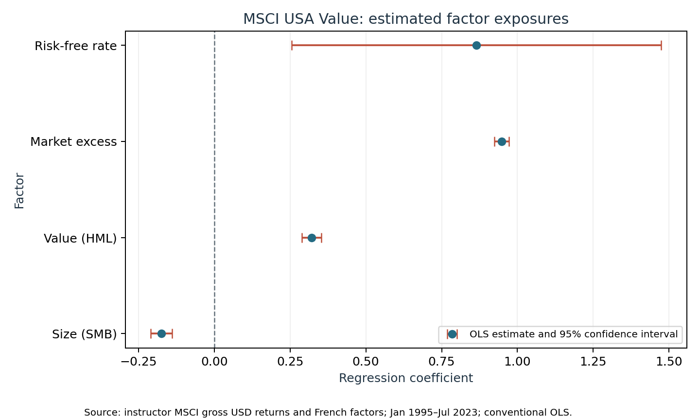
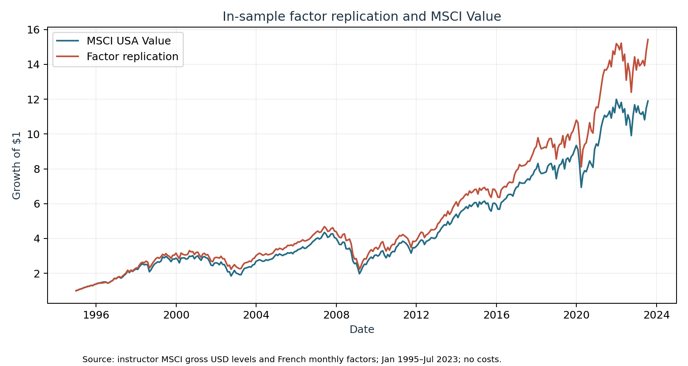
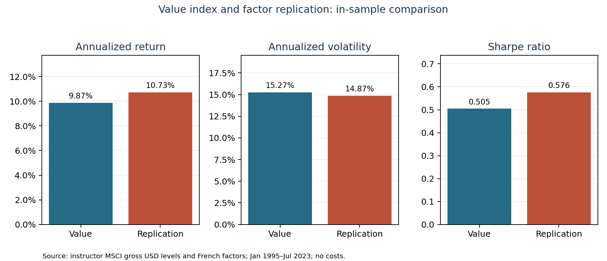
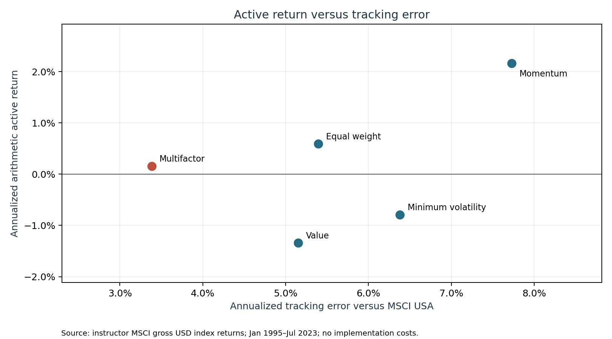
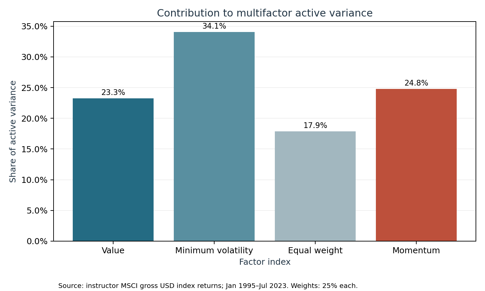

# Part 5: Portfolio analytics

## Data, conventions and scope

We use the [instructor-provided FF/MSCI workbook](../../data/raw/ff_msci_shared.xlsx), containing MSCI USA Standard (Large + Mid Cap) gross USD total-return index levels and the Fama–French monthly factors. We convert month-end levels to simple monthly returns, using December 1994 as the starting level. The analysis covers January 1995–July 2023: 343 aligned months. French factor data are in percent in the workbook and are converted to decimals. Returns are historical and gross of implementation costs.

The four-factor index is the equal-weighted average of Value, Minimum Volatility, Equal Weighted and Momentum monthly returns, implying monthly rebalancing to 25% weights. Annualized average returns and active returns are 12 times the arithmetic monthly mean; volatility and tracking error are the sample monthly standard deviation times sqrt(12). Sharpe subtracts 12 times the monthly average RF before dividing by annualized total-return volatility. This is consistent with the arithmetic Sharpe convention; it is not CAGR.

## 5A — Factor composite definitions

MSCI's February 2021 methodology defines value using book value to price, 12-month forward earnings to price and dividend yield. Its growth indicators are long- and short-term forward EPS growth, current internal growth, long-term historical EPS growth and long-term historical sales-per-share growth. Value and growth are separate dimensions, so a security can exhibit both characteristics. Missing indicators are excluded rather than treated as zero.

The same growth indicators do not apply universally. Long-term forward EPS growth is omitted for the Small Cap style indexes. Historical sales-per-share growth is not used for Banks and Diversified Financials, except the specified Multi-Sector Holdings and Financial Exchanges & Data sub-industries; MSCI classifies these under GICS. The small-cap exception is a broader methodology detail: the MSCI USA Standard index used below contains large and mid caps.

For the Standard index, long-term forward EPS growth receives double weight in the growth score; missing variables are excluded. MSCI describes a two-dimensional classification in which a security can be allocated partially to both style indexes. The current document describes a methodology introduced in 2003, so it should not be assumed that the exact same rules governed every month of the 1995–2023 sample.

Fama–French HML instead uses book-to-market as the value characteristic in size and book-to-market sorts. HML is an average high-minus-low return spread across small and big portfolios, whereas the MSCI Value index is a long-only style index built from multiple indicators. Thus a regression coefficient on HML represents exposure to that academic spread, not identical index construction.

Sources: [MSCI Global Investable Market Value and Growth methodology, February 2021](https://www.msci.com/eqb/methodology/meth_docs/MSCI_GIMIVGMethod_Feb2021.pdf), pp. 5, 9–10, 12–13; [Kenneth French factor descriptions](https://mba.tuck.dartmouth.edu/pages/faculty/ken.french/Data_Library/f-f_factors.html).

## 5B — MSCI Value factor exposures

We regress the MSCI Value monthly total return on an intercept, RF, Mkt−RF, HML and SMB for the same month:

`Value_t = α + b_RF RF_t + b_M (Mkt−RF)_t + b_H HML_t + b_S SMB_t + ε_t`.

The dependent variable is a total return. The market, HML and SMB factors are return spreads, so RF is included once as its own regressor rather than being subtracted from each spread. There is one index return per month, so this is a time-series regression even though the assignment calls it a pooled panel regression. We estimate RF's coefficient rather than fixing it to one, as requested. Standard errors and t-statistics are conventional OLS; no Newey–West adjustment is used.

| Term | Coefficient | OLS t-statistic |
|---|---:|---:|
| Intercept | -0.000713 | -0.906 |
| RF | 0.8646 | 2.788 |
| Mkt−RF | 0.9480 | 76.986 |
| HML | 0.3216 | 19.682 |
| SMB | -0.1744 | -9.905 |

The model's in-sample R² is 0.9484. A positive and statistically significant HML loading is consistent with the index's advertised value exposure. Its market loading is substantial; the negative SMB coefficient indicates a tilt toward the large-cap side of the French size spread, consistent with a large- and mid-cap universe. The RF t-statistic tests whether its coefficient is zero, not whether it equals one. These exposures are estimated averages over this sample and do not establish identical construction or future loadings.



## 5C — Does MSCI's definition improve performance?

The monthly intercept is -0.0713%, or approximately -0.855% per year when multiplied by 12. Its OLS t-statistic is -0.906 (two-sided p = 0.366). After adjusting for the fitted RF, market, HML and SMB exposures, we therefore do not find statistically significant positive alpha for MSCI Value relative to this specification.

This comparison does not isolate the causal effect of MSCI's additional value indicators. The portfolios differ in universe, weights and construction; the estimated factor model is incomplete and uses the same sample throughout. Failure to find positive alpha is not proof that the MSCI definition adds no value in other periods or settings.

## 5D — Replicating the value index

The fitted replicating return excludes the intercept:

Replication = 0.8646 × RF + 0.9480 × (Mkt−RF) + 0.3216 × HML − 0.1744 × SMB.

The return correlation with MSCI Value is 0.9739, indicating that the replication tracks much of the index's month-to-month variation in this sample. High correlation does not imply the same cumulative performance or a low tracking error. The coefficients were estimated and evaluated on the same observations, so this is an in-sample comparison, not a prospective backtest. Since OLS residuals have sample mean zero, omitting the negative intercept mechanically raises the replication's average return above Value's by approximately 0.855 percentage points per year; this gap is not independent out-of-sample evidence of superiority.

| Portfolio | Annualized arithmetic return | Annualized volatility | Sharpe ratio |
|---|---:|---:|---:|
| MSCI USA Value | 9.87% | 15.27% | 0.505 |
| Factor replication | 10.73% | 14.87% | 0.576 |

On these gross historical metrics, the replication has the higher return and Sharpe ratio and slightly lower volatility. This is not enough to establish a superior investable product. The coefficients include a negative SMB position and exposure to long–short factor returns, so real implementation would require feasible instruments, financing and shorting. Before choosing, examine: (1) transaction, borrowing, financing and management costs; (2) investable instruments, liquidity and rebalancing; and (3) whether exposures and performance remain stable in an out-of-sample period.





## 5E — Relative performance of the multifactor index

We subtract MSCI USA's same-month total return from each component and from the four-index average. Because the components have equal weights, the multifactor active return equals the average of the four component active returns.

| Metric | Result |
|---|---:|
| Annualized arithmetic active return | 0.152% |
| Annualized tracking error | 3.387% |
| Annualized information ratio | 0.045 |

The component active returns and tracking errors put that result in context:

| Index | Annualized active return | Annualized tracking error | Information ratio |
|---|---:|---:|---:|
| Value | -1.343% | 5.154% | -0.261 |
| Minimum volatility | -0.796% | 6.380% | -0.125 |
| Equal weighted | 0.588% | 5.396% | 0.109 |
| Momentum | 2.158% | 7.730% | 0.279 |
| Multifactor | 0.152% | 3.387% | 0.045 |

The multifactor portfolio's tracking error is lower than that of each component in this sample because the components' active returns do not move perfectly together. Diversification of active risk does not guarantee positive excess return.

The information ratio is 0.152% / 3.387% = 0.045. The observed excess return is small relative to the variability of active returns. It is a descriptive historical result before costs, not evidence that future active return must be positive. The tracking error measures risk relative to MSCI USA, not the multifactor index's total volatility.



## 5F — Active risk decomposition

Let A be the multifactor active return and A_i a component's active return. With equal weights, A = (1/4)Σ A_i and therefore Var(A) = (1/4)Σ Cov(A, A_i). We compute sample covariances consistently with the tracking-error calculation. Each variance contribution includes the component's co-movement with the other components; it is not its standalone variance.

| Component | Share of active variance | Contribution to annualized tracking error |
|---|---:|---:|
| Value | 23.26% | 0.79 percentage points |
| Minimum volatility | 34.08% | 1.15 percentage points |
| Equal weighted | 17.86% | 0.60 percentage points |
| Momentum | 24.81% | 0.84 percentage points |

Minimum volatility is the largest contributor to this multifactor index's active variance, at 34.08%. The tracking-error contributions allocate the total tracking error in proportion to variance shares and sum to 3.387%; these are not standalone tracking errors.

For an investor whose main objective is controlling absolute portfolio volatility, a standalone low-volatility allocation can be more appropriate than evaluating the strategy solely as an active bet against a capitalization-weighted market. Low-volatility investing can be attractive as a standalone allocation to an investor seeking lower absolute risk, including an investor who cannot cheaply use leverage to scale a defensive portfolio. Against a market benchmark, however, its exposure can produce substantial relative deviations and periods of underperformance when higher-beta stocks rally; benchmarking constraints may make those deviations hard to tolerate. The decomposition alone does not identify a universally better implementation or prove the limits-to-arbitrage mechanism. The choice depends on the investor's risk target, benchmark, leverage constraints and ability to bear tracking error.



## Reproduction and verification

The [output directory](../../outputs/part5/) contains the aligned monthly panel, regression coefficients, replication and active-performance metrics, component statistics, risk decomposition, diagnostics and five figures. Decimal units are used in the CSVs; percentages in this report are converted for presentation. The source workbook's economic accuracy has not been independently audited.

From the repository root, using the project's documented environment:

```sh
python run_all.py --part 5
python -m unittest discover -s tests -v
```

The runner checks shared source integrity and generates the analysis tables before the figures. The regression and performance comparisons are in-sample and gross of implementation costs. The data, coefficients, covariance identity and generated result tables are checked by the Part 5 tests; visual rendering can vary across systems.

[Project reports](../README.md) · [Part 5 execution guide](../../src/part5/README.md)
