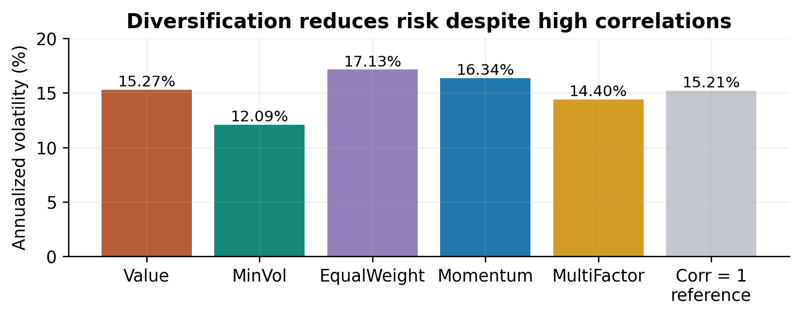
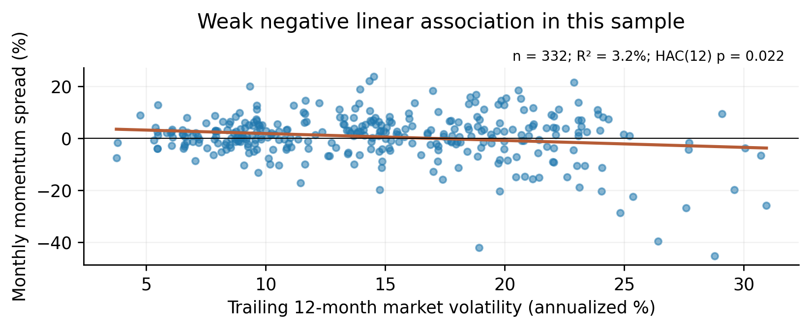

# Part 1 Factor Investing

Part 1 uses the shared instructor workbook. See the [standalone analysis guide](../../src/part_1/README.md) and [numerical tables](../../outputs/part_1/tables/). The [final report](../final_report/FE5108_Final_Project_Report.pdf) contains the submission text; `run_all.py` covers Parts 2–5.

We examine whether academic factor premia persist, how investable factor indexes differ, and whether diversification and market volatility affect their outcomes. All numerical results use the classroom workbook [1]. MSCI comparisons cover January 1995 to July 2023, using 343 monthly Gross USD returns.

## 1A Factor premia and statistical evidence

Exhibit P1A reports ordinary mean t statistics using arithmetic monthly returns, without autocorrelation adjustment as permitted. Before 1993, t values for Mkt−RF, SMB and HML are 3.22, 2.13 and 3.33; afterwards they are 3.09, 0.60 and 0.83. At the 5% two-sided level, all three earlier means are significant, but only the later market mean is. Size and value therefore warrant less investment conviction. Their lower later means do not establish disappearance: supplementary independent-window mean-difference tests have approximate p values of 0.484 and 0.185. Neither rejects equal means at 5%, and publication is not identified as the cause.

For subsequent analysis, we subtract the lowest momentum decile from the highest, and the highest beta decile from the lowest, using value-weighted monthly portfolios [3,4]. These are return spreads. They are not compounded as standalone fully invested portfolios, and the momentum spread is not replaced by the library’s different 2-by-3 Mom factor.

## 1B MSCI momentum construction

The assigned December 2013 methodology [5] starts from MSCI USA large- and mid-cap constituents. Six- and twelve-month local price gains, excluding the latest month and less local risk-free rates, are scaled by three-year weekly-return volatility. Each risk-adjusted signal is standardized across stocks by subtracting its cross-sectional mean and dividing by its cross-sectional standard deviation. The two Z scores are equally combined and standardized again; the final Z is clipped at ±3 and mapped to a positive score: 1+Z for Z>0, and 1/(1−Z) otherwise. Selection ranks unclipped Z scores, with parent weight breaking ties. For a reviewed target of N stocks, the top 0.5N ranks enter first; incumbents ranked up to 1.5N are then retained in rank order until N places are filled, with any vacancies filled by rank. Final weights normalize parent weight times momentum score, subject to a 5% USA issuer cap.

This combines size and signal strength. For example, parent weights of 2% and 1%, with scores of 1.5 and 2, give raw weights of 0.03 and 0.02 before normalization and caps. The stronger signal need not receive the greater allocation. In our interpretation, capitalization supports trading capacity and reduces the risk of oversized positions in small stocks with strong signals relative to pure signal weighting. It can dilute momentum exposure and retain large-company concentration.

Scheduled reviews occur in May and November. Extra reviews monitor exceptional relative increases in the parent’s three-month daily volatility against a historical 95th-percentile threshold, using World as the USA reference. They use only six-month momentum to mitigate volatility-spike drawdowns [5]. This monthly-data exercise does not replicate that daily trigger or assume the 2013 rules held throughout the full return history.

<!-- Body page 2 -->

## 1C Diversification and investment performance

The four factor indexes are reset to 25% each month. Exhibit P1B uses arithmetic annualized means and the assignment Sharpe definition: annualized mean less RF mean, divided by strategy-return volatility. Momentum has the highest mean (13.38%); Value the lowest (9.87%). Momentum and MinVol have nearly tied Sharpes (0.686 and 0.683), without a formal test of their difference. Value also has the lowest factor-index Sharpe (0.505). The mix has mean 11.37%, volatility 14.40% and Sharpe 0.639, versus USA’s 11.22%, 15.44% and 0.586. Its Sharpe exceeds USA, Value and EqualWeight, but remains below Momentum and MinVol.

Exhibits P1C(a)–(b) quantify diversification. Pairwise factor-index return correlations are 0.783–0.951. With the same individual volatilities but perfect positive correlation, the mix’s volatility would equal their weighted average, 15.21%. The observed 14.40% is lower by 0.81 percentage points, or 5.3% relative to that analytical reference. Imperfect correlation therefore reduces risk, despite substantial common equity exposure. This does not identify a tradable benchmark or imply dominance over MinVol alone, whose volatility is 12.09%. Returns are gross of implementation costs; CAGR is supplementary, not substituted for the mean.

## 1D Sensitivity to factor construction

Exhibit P1D correlates each MSCI factor return less USA with the four academic spreads. Corresponding correlations are 0.728 for Value–HML, 0.322 for EqualWeight–SMB, 0.643 for momentum and 0.815 for MinVol–low beta. Factor identities remain recognizable, but construction matters. EqualWeight is a weak substitute for SMB and correlates more with HML (0.431). Academic spreads use broader stock sorts, while MSCI active returns subtract a large/mid-cap index. HML balances value spreads across size groups; equal weighting is not a pure size sort, and minimum variance is not a beta sort. These comparisons describe co-movement, not causal exposure estimates [2–4].

## 1E Momentum and market volatility

From December 1995 to July 2023, trailing twelve-month Mkt−RF volatility is negatively associated with same-month decile momentum. OLS gives a slope of -0.267, HAC(12) p=0.022 and R²=3.2% (Exhibit P1E). A ten-percentage-point increase in annualized market volatility corresponds to 2.67 percentage points lower monthly momentum return. The relation is not monotonic: low-, middle- and high-volatility terciles have annualized mean spreads of 12.47%, 22.34% and −12.33%.

The prior-month volatility specification avoids including contemporaneous market returns, but explains only 2.2% of momentum variation (HAC(12) p=0.036). Its significance is sensitive to extreme months in the supplementary influence diagnostic. We conclude that this sample contains a weak negative linear association, with particularly poor average momentum in high-volatility states. It does not establish stable forecasting ability, causality or the performance of MSCI’s conditional review rule. Full-sample results remain primary; the influence diagnostic is summarized in the note to Exhibit P1E.

## Part 1 Exhibits

### Exhibit P1A Mean factor return tests

| Period | Factor | Months | Monthly mean | Annual mean | Mean t |
| --- | --- | --- | --- | --- | --- |
| 1927–1992 | Mkt-RF | 792 | 0.655% | 7.86% | 3.219 |
| 1927–1992 | SMB | 792 | 0.240% | 2.88% | 2.126 |
| 1927–1992 | HML | 792 | 0.435% | 5.22% | 3.333 |
| 1993–Jul 2023 | Mkt-RF | 367 | 0.719% | 8.62% | 3.091 |
| 1993–Jul 2023 | SMB | 367 | 0.099% | 1.19% | 0.599 |
| 1993–Jul 2023 | HML | 367 | 0.146% | 1.75% | 0.830 |

Source: classroom FF3 monthly US research factors [1,2]. Annual mean is 12 times the monthly arithmetic mean; t uses the sample standard deviation divided by the square root of the observation count. No HAC adjustment is applied.

### Exhibit P1B Index performance

| Index or asset | Annual mean | Annual volatility | Sharpe | CAGR |
| --- | --- | --- | --- | --- |
| USA | 11.22% | 15.44% | 0.586 | 10.49% |
| Value | 9.87% | 15.27% | 0.505 | 9.05% |
| MinVol | 10.42% | 12.09% | 0.683 | 10.13% |
| EqualWeight | 11.81% | 17.13% | 0.563 | 10.82% |
| Momentum | 13.38% | 16.34% | 0.686 | 12.72% |
| MultiFactor | 11.37% | 14.40% | 0.639 | 10.82% |
| RF | 2.16% | 0.61% | 0.000 | 2.18% |

Source: classroom MSCI USA large/mid-cap Gross USD indexes and FF RF [1]. January 1995–July 2023; 343 monthly observations. MultiFactor resets the four factor-index weights to 25% monthly. Volatility uses the sample standard deviation times √12; Sharpe uses strategy-return volatility as required. RF gives zero under the literal formula, but is not a meaningful risk-adjusted ranking: its variation reflects changing bill rates. No costs or fees are deducted.

### Exhibit P1C(a) Risk diversification benchmarks

| Risk reference | Annual volatility |
| --- | --- |
| Weighted mean of four individual volatilities | 15.21% |
| Four-index mix using observed covariance | 14.40% |
| MSCI USA market index | 15.44% |
| MSCI USA MinVol alone | 12.09% |

Same source, universe and period as Exhibit P1B. Holding each constituent volatility fixed, perfect positive correlation gives the first-row risk level. The mix reduces volatility by 0.81 percentage points (5.3% relative). This analytical reference isolates imperfect-correlation benefits; it is not an investable alternative portfolio.

## Exhibit P1C(b) Correlation and portfolio risk

| Index | Value | MinVol | EqualWeight | Momentum |
| --- | --- | --- | --- | --- |
| Value | 1.000 | 0.924 | 0.951 | 0.783 |
| MinVol | 0.924 | 1.000 | 0.893 | 0.828 |
| EqualWeight | 0.951 | 0.893 | 1.000 | 0.808 |
| Momentum | 0.783 | 0.828 | 0.808 | 1.000 |

Source: classroom MSCI USA factor-index Gross USD monthly returns, January 1995–July 2023, n=343. This table uses total returns; Exhibit P1D instead uses returns relative to USA. Portfolio variance is calculated from the same sample covariance matrix with four 25% weights.

Source and period as above. The grey bar holds each individual volatility fixed and sets all pairwise correlations to +1. Common equity exposure limits the size of the diversification benefit.

### Exhibit P1D Academic and MSCI factor correlations

| MSCI less USA | HML | SMB | High–low mom | Low–high beta |
| --- | --- | --- | --- | --- |
| Value | 0.728 | -0.177 | -0.243 | 0.415 |
| MinVol | 0.232 | -0.307 | 0.303 | 0.815 |
| EqualWeight | 0.431 | 0.322 | -0.448 | -0.199 |
| Momentum | -0.223 | 0.079 | 0.643 | 0.140 |

Source: classroom MSCI USA Gross USD indexes and FF monthly US research portfolios [1–4]. January 1995–July 2023, n=343 in every cell. Rows subtract USA from each factor-index return. Columns are HML, SMB, highest minus lowest momentum decile, and lowest minus highest beta decile; decile legs use value-weighted returns.

## Exhibit P1E Momentum and market volatility

| Volatility window | Months | Slope | HAC SE | Approx p | R squared |
| --- | --- | --- | --- | --- | --- |
| Through current month | 332 | -0.267 | 0.116 | 0.022 | 3.2% |
| Through prior month | 332 | -0.221 | 0.106 | 0.036 | 2.2% |

Source: classroom US FF Mkt−RF and value-weighted momentum deciles [1–3]. December 1995–July 2023. Predictor: trailing twelve-month sample standard deviation times √12; outcome: monthly high-minus-low momentum spread. Bartlett HAC(12), T/(T−2) correction, asymptotic normal two-sided p values. Returns and volatility enter as decimals. The first prior-month window uses December 1994–November 1995; the primary current-month window uses January–December 1995.

| Current volatility tercile | Months | Annual mean momentum |
| --- | --- | --- |
| Low | 111 | 12.47% |
| Middle | 110 | 22.34% |
| High | 111 | -12.33% |

Same source and period. Terciles use full-sample volatility ranks, not real-time trading thresholds. Annualized means are descriptive spreads, not compound strategy returns. The middle tercile outperforms the low tercile, so the relationship is not uniformly decreasing.

Source and period as above; each point is a month and the line is descriptive OLS. Influence diagnostic: omitting the two worst momentum months (January 2001 and April 2009) raises the lagged-model HAC(12) p value from 0.036 to 0.075. This post hoc diagnostic preserves calendar spacing; it is not a cleaned sample or a confirmatory test. Primary results retain all 332 months.

### Sources

[1] [Classroom Excel for Parts 1 and 5, July 2023 FF vintage.](../../data/raw/ff_msci_shared.xlsx)

[2] [Kenneth French, Fama French Three Factors construction.](https://mba.tuck.dartmouth.edu/pages/faculty/ken.french/Data_Library/f-f_factors.html)

[3] [Kenneth French, Ten Portfolios Formed on Momentum.](https://mba.tuck.dartmouth.edu/pages/faculty/ken.french/Data_Library/det_10_port_form_pr_12_2.html)

[4] [Kenneth French, Portfolios Formed on Market Beta.](https://mba.tuck.dartmouth.edu/pages/faculty/ken.french/Data_Library/det_port_form_BETA.html)

[5] [MSCI Momentum Indexes Methodology, December 2013, pp. 4–10.](https://www.msci.com/eqb/methodology/meth_docs/MSCI_Momentum_Indices_Methodology.pdf)

Official method pages accessed 19 October 2026; MSCI methodology rechecked 21 October 2026. Classroom inputs are kept unchanged; current website returns are not mixed into the calculations. The MSCI rules cited are the assigned historical version, not a claim about every historical index observation.

[All reports](../README.md)
