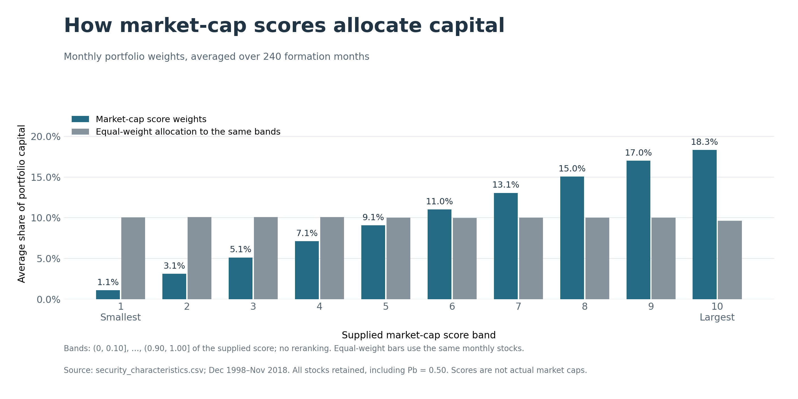
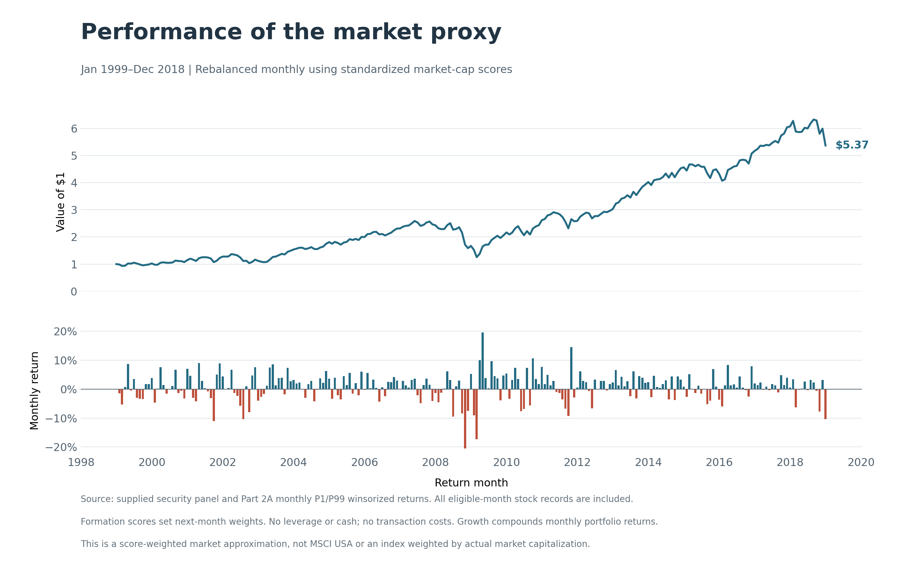

# Part 2B: broad-market portfolio

## 1. Market-cap score weighting

For each formation month from December 1998 to November 2018, we divide each stock's standardized market-cap score by the sum of scores across that month's stocks. The next-month portfolio return is the weighted sum of the Part 2A winsorized stock returns. We rebalance monthly, retain Pb = 0.50 observations, and assume no transaction costs. The resulting 240 returns cover January 1999–December 2018. All weights are nonnegative and sum to one in each month; unavailable scores or outcomes trigger an error rather than silent stock deletion.

The highest market-cap score band receives an average 18.3% of capital, versus 1.1% for the lowest band. Equal weighting of the same stocks allocates 9.6% and 10.1%, respectively. The score-based rule therefore tilts capital toward larger-ranked stocks. It does not reproduce true capitalization weights: a score twice as large does not imply twice the actual market cap.

The chart groups stocks by fixed supplied score bands, (0, 0.10], ..., (0.90, 1.00], and averages each band's capital share equally across months. The gray comparison is the fraction of stocks in each band, not a separate equal-weight performance backtest.

A $1 investment grows to $5.37 over the 240 months under these assumptions. The lower panel displays the monthly returns; the upper panel compounds them from December 1998. The portfolio is an approximate market benchmark, not an exact MSCI replication.

Run `python run_all.py --task return_distribution` first if the shared cleaned panel is absent, then `python run_all.py --task market_portfolio`; `--all` runs both in dependency order. Code: `src/part_2/broad_market/market_portfolio.py`. Results: `outputs/part_2/broad_market/` (returns, security weights, monthly/average band allocations and PNG/SVG figures). Stock weights are keyed by strategy, formation_month and stock_id; returns use realized month. The shared raw CSV remains unchanged.

## 2. MSCI USA comparison

See [MSCI USA comparison](benchmark_comparison.md) for the aligned cumulative-growth chart, monthly-return scatter and interpretation. Run `benchmark_comparison` after this task.

[Back to Part 2](../README.md)
