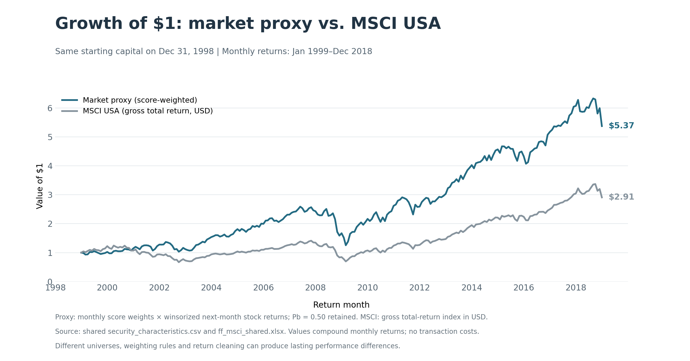
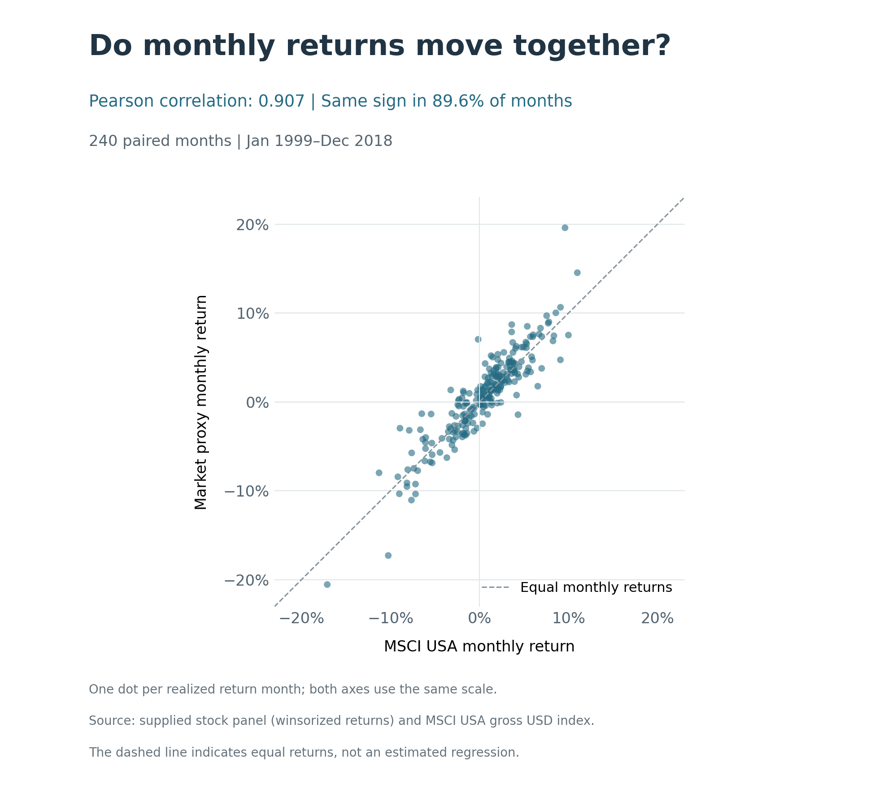

# Part 2B: comparison with MSCI USA

Both series start at $1 on December 31, 1998. By December 2018, the market proxy reaches $5.37, compared with $2.91 for MSCI USA. The cumulative chart shows common market movements as well as a substantial long-run performance difference.

Monthly returns show a clear positive relationship, with the scatter broadly following the y = x line. Their correlation is 0.907, and they move in the same direction in 89.6% of months. The cumulative paths also show similar rises and falls, despite different terminal values. This strengthens our confidence that the supplied data capture broad US equity-market movements and that the returns are broadly reasonable. It does not verify every stock return. Differences in stock coverage, score-based weighting and winsorization may contribute to the performance gap; the comparison does not isolate these effects.

## Method

The shared workbook's `MSCI - factor totret index` sheet provides `USA Standard (Large+Mid Cap)` index levels, explicitly labeled Gross and USD. We convert consecutive monthly levels into returns using L(t)/L(t−1)−1, retaining December 1998 to calculate January 1999. Month-end trading dates are aligned by calendar month. The proxy is joined on realized return month, not formation month. All 240 months are present; no dates are dropped. Proxy returns retain the previously agreed monthly P1/P99 cleaning; MSCI returns are not winsorized.

The main figure compounds both return series with the same initial value. The supplementary scatter uses equal horizontal and vertical scales and an equality line, not a fitted regression. Pearson correlation measures monthly co-movement; tracking error uses sample standard deviation (ddof=1) multiplied by sqrt(12). All figures and their paired-return/metric tables are in `outputs/part_2/broad_market/`.

Run `python run_all.py --task benchmark_comparison` after `market_portfolio`, or run `--all` in dependency order. Sources: shared `data/raw/ff_msci_shared.xlsx` and the registered security panel. This analysis does not modify either source.

[Back to Part 2B](README.md)
