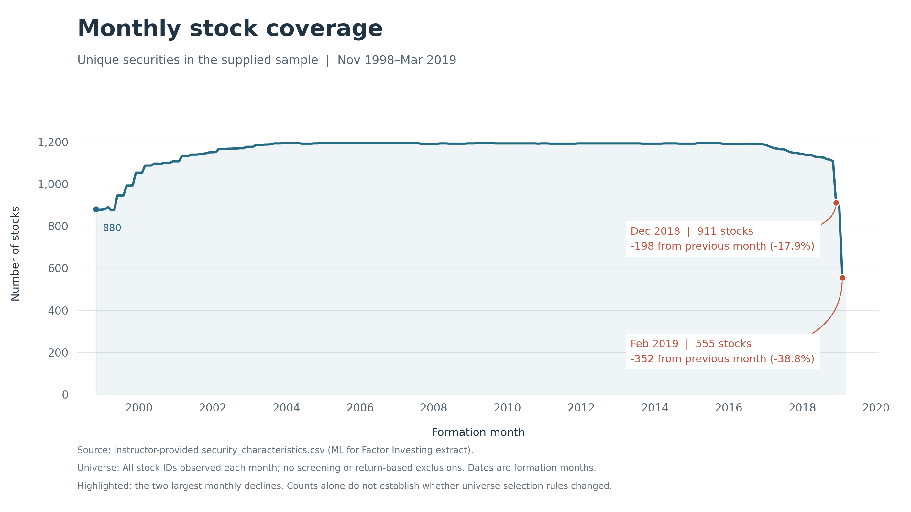

# Monthly stock coverage

Stock counts were broadly stable around 1,200 for much of the sample, but fell sharply near the end. December 2018 and February 2019 are particularly questionable because the declines were large in both absolute and percentage terms: the count fell from 1,109 to 911 in December 2018, a loss of 198 stocks (17.9%), and from 907 to 555 in February 2019, a loss of 352 stocks (38.8%). These abrupt drops raise concerns about the consistency of data coverage, although counts alone cannot establish the cause.

Source: instructor-provided security-level CSV; all observed stock IDs by formation month, November 1998–March 2019.
