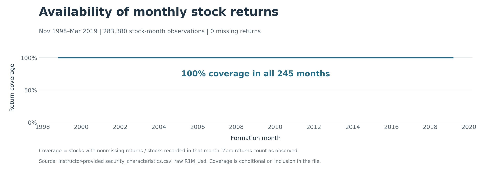

# Return coverage

Return coverage is 100% in all 245 months of the supplied history, with no missing returns among 283,380 stock-month observations. No missing-return treatment is therefore required.

The figure uses a compact time-series line chart with a 0–100% reference scale and headroom above 100% to keep the line visible. A single annotation summarizes the constant coverage; repeated monthly labels would add no information. Coverage is measured within the stocks recorded each month, so it does not establish that the stock universe itself is complete. Zero returns count as observed. Dates are formation months, November 1998–March 2019; the return field refers to the following month.

## If returns were missing

We would first distinguish extraction errors from gaps associated with delisting, trading suspensions or other corporate events in the relevant return month. Such events do not automatically imply an unavailable return. In particular, delisting proceeds and losses should be captured where available rather than discarded. The anonymized stock IDs in this file prevent direct matching to external securities, so this investigation would require help or an identifier mapping from the instructor or data provider.

For extraction errors, we would first recover the original observations or obtain compatible returns from another reliable source, checking the month, currency, dividend treatment and corporate-action adjustments. If gaps were widespread, we would assess whether a reliably covered sample period could be used and disclose the resulting scope change rather than fill a large share of the sample mechanically.

For unresolved gaps, treatment depends on the analysis. Excluding a small number of observations may be acceptable for descriptive statistics if the missingness is not systematically related to returns, with coverage disclosed. In a portfolio backtest, an unavailable future return must not be used to exclude a stock at formation or retroactively redistribute its weight. Existing holdings require an explicit valuation or loss assumption tied to available evidence, with sensitivity analysis where that assumption is uncertain. If no defensible assumption is available, affected portfolio-month returns should remain unavailable rather than be presented as complete.

We would not use linear interpolation or mean imputation as the default for stock returns. Both can suppress volatility and alter correlations; interpolation using later returns also introduces future information. Any model-based estimate would be identified as an estimate and evaluated separately from observed performance. Preserving a continuous-looking series is not sufficient reason to invent realized returns.

Method reference: [CRSP aggregate return flags](https://www.crsp.org/wp-content/uploads/appendix/FlagType_AR.html) distinguish delisting returns, incomplete periods and missing-price cases. These are methodological examples, not evidence that the supplied teaching extract follows CRSP conventions.

Source: `data/raw/security_characteristics.csv`, raw `R1M_Usd`. Figure and monthly counts: `outputs/part_2/data_validation/return_coverage/`. Producer: `src/part_2/data_validation/return_coverage.py`, registered as `return_coverage` in `run_all.py`. Missing checks cover blank strings, NA/NaN/null and nonfinite numeric values; no undocumented numeric sentinel conventions are imposed.
