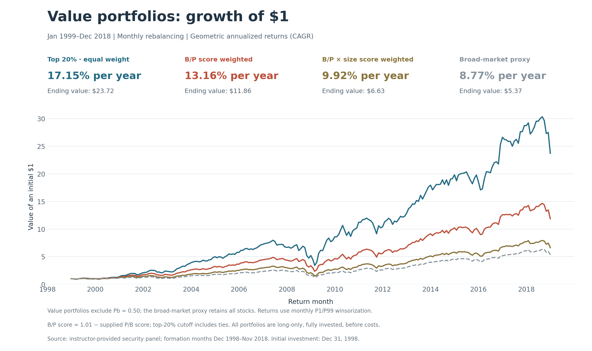

# Part 2C: value portfolios

## 1. Annualized returns

Each month, we exclude Pb = 0.50 and reverse the supplied 0.01–1.00 P/B score as B/P score = 1.01 − Pb, without reranking the remaining stocks. This reverses the percentile scale; it does not recover raw B/P. We construct (1) an equal-weight portfolio of the highest B/P 20%, (2) weights proportional to B/P scores, and (3) weights proportional to B/P scores times market-cap scores. The first rule selects ceil(20% × eligible stocks), including all ties at its boundary. Each rule is normalized to sum to one.

Formation months December 1998–November 2018 produce 240 monthly returns for January 1999–December 2018. We use the Part 2A winsorized forward returns, rebalance monthly and assume no transaction costs. The Part 2B market proxy is unchanged, including its retention of Pb = 0.50.

| Portfolio | Annualized return (CAGR) | Ending value of $1 |
|---|---:|---:|
| Top 20% · equal weight | 17.15% | $23.72 |
| B/P score weighted | 13.16% | $11.86 |
| B/P × size score weighted | 9.92% | $6.63 |
| Broad-market proxy | 8.77% | $5.37 |

Annualized return is geometric: [product of (1 + monthly return)]^(12/240) − 1. The chart starts at $1 on December 31, 1998 and compounds the same monthly returns.

**Top 20% · equal weight has the highest annualized return.** The top-20% strategy invests only in the cheapest stocks, whereas the other two strategies also allocate weight to relatively more expensive stocks, diluting their value exposure. Equal weighting avoids giving larger stocks additional weight within the selected group. These features may help explain its higher return and volatility, although this comparison cannot separate the effects of stock selection and weighting. Comparisons with the market also reflect the different treatment of Pb = 0.50.

As a sensitivity check, retaining Pb = 0.50 gives annualized returns of 17.05%, 13.32% and 10.02%, respectively. These observations remain of uncertain interpretation; this check does not validate their P/B values.

Run `python run_all.py --task value_returns` after `return_distribution` and `market_portfolio`, or use `--all`. Code: `src/part_2/value_portfolios/value_returns.py`. Tables and PNG/SVG figure: `outputs/part_2/value_portfolios/`. Security weights are generated locally; monthly diagnostics record holdings, weight sums and weighted characteristic scores.

## 2. Annualized standard deviation

| Portfolio | Annualized standard deviation |
|---|---:|
| Top 20% · equal weight | 22.02% |
| B/P score weighted | 18.70% |
| B/P × size score weighted | 17.32% |
| Broad-market proxy | 16.48% |

We use the same 240 monthly returns (January 1999–December 2018). Annualized standard deviation equals the monthly sample standard deviation (ddof = 1), calculated around the arithmetic mean, times sqrt(12). This is the conventional square-root-of-time annualization; the return comparison above uses geometric compounding.

**Top 20% · equal weight has the highest volatility**, at 22.02%, versus 16.48% for the broad-market proxy. The top-20% rule holds a narrower set of value stocks and has greater exposure to smaller-ranked stocks. These features plausibly contribute to its higher volatility; fewer holdings alone do not determine portfolio risk, which also depends on individual stock volatility and co-movement. Its higher realized return therefore comes with greater fluctuations in this sample. The available comparison does not isolate each source of risk.

Underlying table: `outputs/part_2/value_portfolios/annualized_volatility.csv`; regenerated by the same `value_returns` task. No additional figure is used for this question.

## 3. Final-period holdings

Formation month: November 2018; corresponding return month: December 2018. Counts include strictly positive weights after the baseline Pb = 0.50 exclusion. These are formation weights, before subsequent return-driven drift.

| Value portfolio | Stocks held | Maximum single-stock weight |
|---|---:|---:|
| Top 20% · equal weight | 218 | 0.4587% |
| B/P score weighted | 1,057 | 0.1849% |
| B/P × size score weighted | 1,057 | 0.3954% |

Source: the generated security-level weights. Reproducible summary: `outputs/part_2/value_portfolios/final_period_holdings.csv`. The top-20% boundary includes ties, as specified above. The top-20% equal-weighted portfolio holds the fewest stocks (218) and has the highest single-stock weight (0.4587%). This is consistent with allocating capital equally across a much smaller set of stocks than the other two portfolios, which each hold 1,057 stocks.

Multiplying B/P scores by market-cap scores increases the maximum single-stock weight from 0.1849% to 0.3954%. Stocks with high scores on both characteristics receive larger weights, making the largest position more concentrated than under B/P weighting alone. However, its maximum weight remains below that of the top-20% portfolio.

[Back to Part 2](../README.md)
