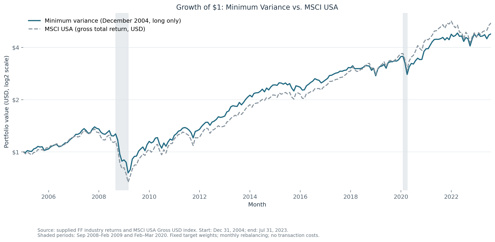

# Part 3: industry portfolio optimization

We compare minimum-variance and inverse-volatility portfolios of 49 US industries. The initial weights use January 1995–December 2004 returns and are evaluated out of sample from January 2005 to July 2023. Target weights are rebalanced monthly without transaction costs. Annualized volatility is monthly sample standard deviation × √12.

## 3A–3C: portfolio construction and risk

The minimum-variance portfolios use the full covariance matrix; inverse-volatility weights use each industry's own volatility. All weights sum to one. Only the shorting-allowed minimum-variance portfolio permits negative weights. The [allocation table](../../outputs/part_3/portfolio_optimization/industry_weights_2004.csv) gives all 49 industry weights.

| Portfolio | In-sample volatility, 1995–2004 | Out-of-sample volatility, 2005–July 2023 |
|---|---:|---:|
| Minimum variance, shorting allowed | 7.59% | 16.75% |
| Minimum variance, long only | 10.32% | 14.29% |
| Inverse volatility | 13.99% | 17.23% |

Allowing short positions gives the lowest in-sample risk because it relaxes the portfolio constraints. This advantage does not persist out of sample: the long-only portfolio has the lowest realized volatility. Estimated covariances and optimized positions need not remain effective in a later period. Inverse-volatility weighting does not explicitly account for correlations and has the highest volatility in both windows.

## 3D: updating the estimates

We re-estimate the long-only minimum-variance weights using January 2006–December 2015 and compare both allocations over January 2016–July 2023 (91 months).

| Allocation | Annualized volatility |
|---|---:|
| Original, estimated through 2004 | 14.52% |
| Updated, estimated through 2015 | 12.81% |

The update reduces realized volatility by 1.71 percentage points in this evaluation window. This supports updating the estimates in this sample, without establishing that every reoptimization improves future performance. See the [weight comparison](../../outputs/part_3/reoptimization/long_only_weights_2004_vs_2015.csv).

## 3E: market performance and crisis periods

The chart compares the original long-only portfolio with the MSCI USA Gross USD index. Both start at $1 at the end of December 2004; the vertical axis is logarithmic (base 2).

| Crisis window | Long-only portfolio | MSCI USA | Portfolio minus market |
|---|---:|---:|---:|
| September 2008–February 2009 | −40.33% | −41.76% | +1.44 pp |
| February–March 2020 | −21.25% | −19.80% | −1.44 pp |

These are compounded returns over each window. The portfolio loses slightly less in the financial crisis but more during the COVID sell-off. Minimizing estimated total variance does not guarantee smaller losses in every market decline. [Industry rankings](../../outputs/part_3/performance_expectations/crisis_industry_rankings.csv) show which sectors performed best in each episode; rankings describe realized outcomes rather than an allocation known in advance.

## Reproduction and source tables

Run `python run_all.py --part 3` from the repository root. The [execution guide](../../src/part_3/README.md) documents all five tasks, inputs, constraints, sample windows and 18 result files. The [in/out-of-sample comparison](../../outputs/part_3/out_of_sample_effectiveness/in_sample_vs_out_of_sample_volatility.csv), [reoptimization results](../../outputs/part_3/reoptimization/reoptimization_volatility.csv) and [crisis table](../../outputs/part_3/performance_expectations/crisis_performance.csv) contain the unrounded results used above.

[All reports](../README.md)
