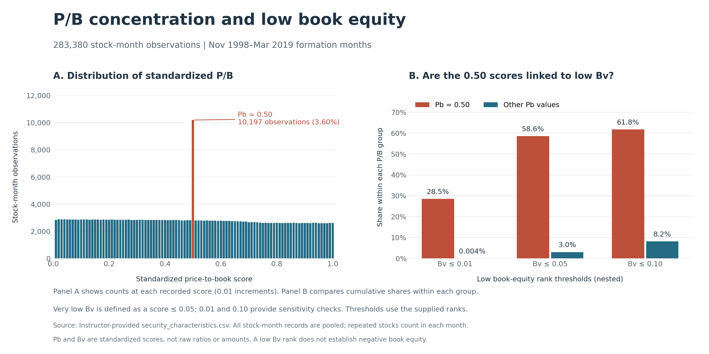

# Standardized price-to-book distribution

The standardized P/B distribution has a clear spike at 0.50, with 10,197 stock-month observations (3.60% of the sample). The adjacent scores, 0.49 and 0.51, contain 2,812 and 2,797 observations, respectively.

We define very low book equity as a supplied Bv score of 0.05 or below and also check thresholds of 0.01 and 0.10. Among observations with Pb = 0.50, 5,976 (58.6%) meet the 0.05 threshold, compared with 3.0% of other observations. At thresholds of 0.01 and 0.10, the corresponding shares are 28.5% versus 0.004%, and 61.8% versus 8.2%. Thus, the 0.50 concentration is strongly associated with low book-equity ranks, but not every observation in this group has low Bv: 41.4% lie above 0.05.

Fama–French HML portfolios require positive book equity. This motivates checking whether the 0.50 spike reflects special treatment of stocks with nonpositive or otherwise unusable book equity. The association supports investigating this explanation, but does not confirm it: Bv is a percentile score, so its sign does not reveal the sign of raw book equity. Ordinary mid-ranked observations may also share the rounded score of 0.50. For subsequent value portfolios, our baseline will exclude stock-month observations with Pb = 0.50, with their inclusion as a robustness check. This is a conservative treatment of an ambiguous valuation signal, not a claim that these stocks have negative book equity. It may exclude valid mid-ranked observations. The rule applies to the affected month, not the entire stock history; portfolio performance comparisons remain to be implemented in Parts 2B–2D.

The figure pools all observations from November 1998 to March 2019. Panel A uses one bar per recorded P/B score rather than a smoothed density, preserving the spike. Panel B uses grouped bars with a common percentage axis; each percentage uses its own P/B group's observations as denominator. Thresholds are nested, not mutually exclusive, and use the supplied rounded scores rather than newly calculated full-sample quantiles. The unit is a stock-month, not a unique company.

Source: `data/raw/security_characteristics.csv`. HML methodology: https://mba.tuck.dartmouth.edu/pages/faculty/ken.french/Data_Library/f-f_factors.html

Producer: `src/price_to_book_distribution.py`; run `python run_all.py --task price_to_book_distribution`. Figure (PNG/SVG) and both underlying tables are in `outputs/price_to_book_distribution/`. No observations or features are changed by this diagnostic.
